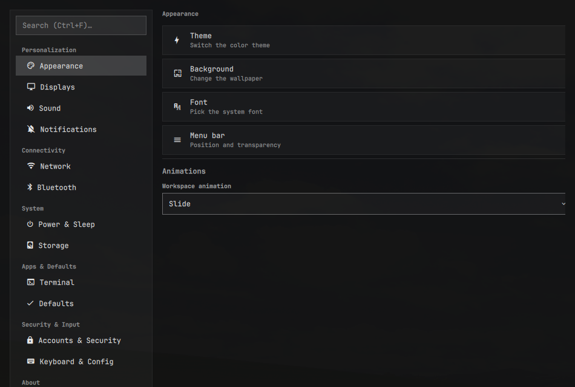
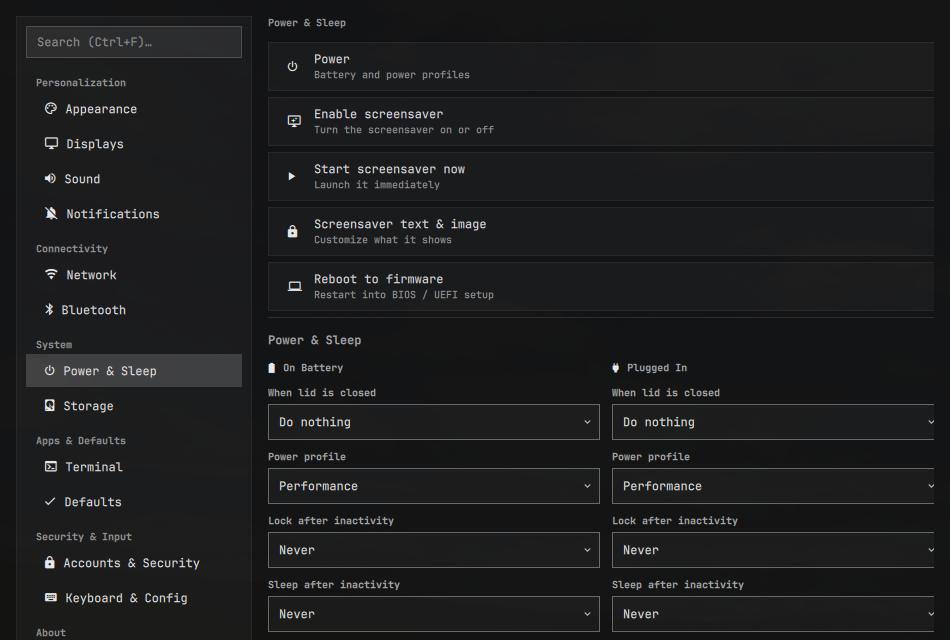
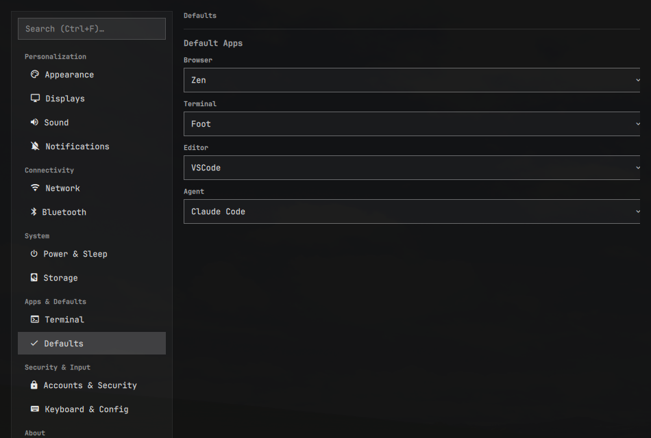
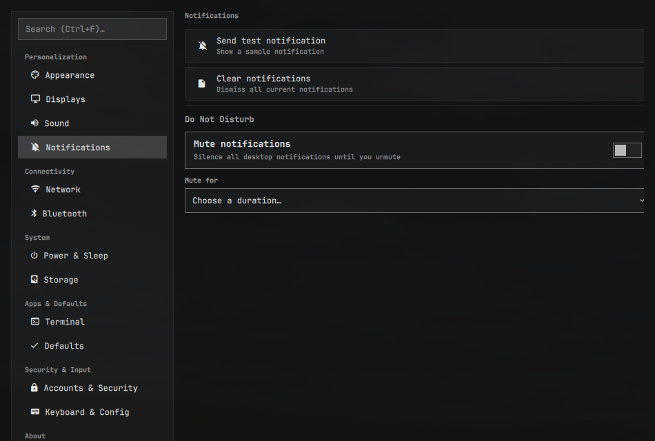

# Omarchestra

A windowed **System Settings** app for [Omarchy](https://omarchy.org/), shipped
as an installable shell plugin. One window aggregates Omarchy's settings — with
search — plus a gear ("cogwheel") in the taskbar.

It is reachable four ways:

1. A keyboard shortcut
2. The launcher menu (opened with **`SUPER + SPACE`** — not ctrl+space; that is
   the Herdr terminal-multiplexer prefix)
3. A gear in the taskbar
4. Clicking the gear

## Screenshots







## Install

```bash
# 1. Install, enable, and place the gear in the bar (prompts for a section,
#    defaulting to "right").
omarchy plugin add https://github.com/Vincent-Lavallee/omarchestra.git --enable
```

`omarchy plugin add` wires the panel and the gear automatically. The remaining
two surfaces are **not** auto-injected by the plugin system (plugins cannot add
menu entries or Hyprland keybindings), so do these once:

```bash
# 2. Launcher-menu entry.
mkdir -p ~/.config/omarchy/extensions
cat >> ~/.config/omarchy/extensions/omarchy-menu.jsonc <<'EOF'
{
  "settings": {
    "icon": "󰐥", "label": "Settings",
    "action": "omarchy-shell shell summon io.github.vincent-lavallee.omarchestra"
  }
}
EOF
```

> `settings` is already an alias of the built-in `setup` submenu; if it collides
> when you search, rename this id (e.g. `settings.app`) and summon that route.

```lua
-- 3. Keybinding, in ~/.config/hypr/bindings.lua
-- SUPER + S is already "Toggle scratchpad"; SUPER + comma is free by default.
o.bind("SUPER + comma", "Settings", "omarchy-shell shell toggle io.github.vincent-lavallee.omarchestra")
```

Reload Hyprland after editing bindings (`hyprctl reload`), or log out and back
in. The binding is remappable — change the chord to whatever you like.

### Administrator access

Power & Sleep and Accounts changes need administrator rights, so they ask for
your password.

The first time you change Power & Sleep, Omarchestra installs a small helper
into a protected system folder and runs it from there — approve the prompt and
it's automatic. The helper is kept out of your home folder so nothing running
as your user can alter it.

Because it lives in a protected folder, plugin updates don't refresh it. If
Power & Sleep ever stops applying after an update, remove the old helper and
apply your settings again — Omarchestra will reinstall it:

```bash
sudo rm -f /usr/local/lib/omarchestra/set-power-settings.sh
```

## Remove

```bash
omarchy plugin remove io.github.vincent-lavallee.omarchestra
```

This uninstalls the plugin and its bar gear. It does not touch the launcher-menu
entry (`~/.config/omarchy/extensions/omarchy-menu.jsonc`) or the keybinding in
`~/.config/hypr/bindings.lua` — delete those by hand if you added them.

It also leaves the helper that Power & Sleep installed in a protected system
folder. To remove that too:

```bash
sudo rm -f /usr/local/lib/omarchestra/set-power-settings.sh
sudo rmdir /usr/local/lib/omarchestra 2>/dev/null || true
```

## Manual open / test

```bash
omarchy-shell shell summon io.github.vincent-lavallee.omarchestra '{}'   # open
omarchy-shell shell toggle  io.github.vincent-lavallee.omarchestra       # toggle
omarchy-shell shell hide    io.github.vincent-lavallee.omarchestra       # close
```

## Sections

| Section | What it offers |
|---|---|
| Appearance | Theme, background, font, menu bar, and a real **Animations** panel (preset + per-motion toggles) |
| Displays | `omarchy.monitor` panel, night-light toggle |
| Sound / Network / Bluetooth | the existing `omarchy.*` panels |
| Power & Sleep | `omarchy.power` panel, lock & idle, screensaver on/off/start/branding |
| Defaults | `setup.default` menu route (browser/terminal/editor/agent) |
| Storage | `omarchy drive info`, disk speed test, `omarchy snapshot` |
| Accounts & Security | `setup.security` menu route, change password, add/remove login accounts |
| Keyboard & Config | `bindings.lua`, `input.lua` editors |

Search (in the sidebar, **Ctrl+F**) matches each setting's label, description,
section, and a rich set of keyword aliases — "wallpaper" / "background" /
"desktop picture" all find the same row. Animation choices write a Hyprland
toggle file (`~/.local/state/omarchy/toggles/hypr/animations.lua`) instead of
opening `looknfeel.lua`, and account add/remove runs bundled scripts in a
floating terminal.

## Known gaps (future work)

- **Lid / sleep behaviors** — configuring `systemd-logind` `HandleLidSwitch*`
  has no single `omarchy` command yet.
- **Live account list + avatars** — add/remove/change-password are wired; a
  read-only account list and avatar picker are future work.

## Dependencies

- **Omarchy** (Arch Linux + Hyprland) — the target distro; reuses its `qs.Ui` /
  `qs.Commons` component kits and `omarchy` / `omarchy-shell` commands.
- **Quickshell** (QML + JavaScript) — the UI runtime, provided by Omarchy.

A few standard tools are used behind the scenes:

- `git` — to install Oh My Zsh (offered when you switch to Zsh)
- `gum` — the account add/remove prompts
- `jq` — to save the idle-lock timeout
- `sudo` / `pkexec` — the administrator actions (Accounts, Power & Sleep)

## Develop

```bash
omarchy plugin validate .            # validate the manifest
omarchy plugin validate --help       # see validation rules
```
